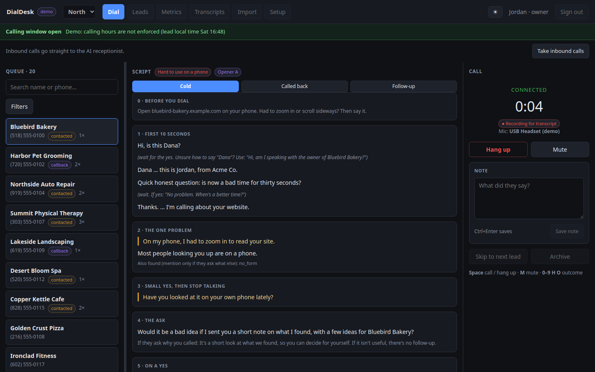
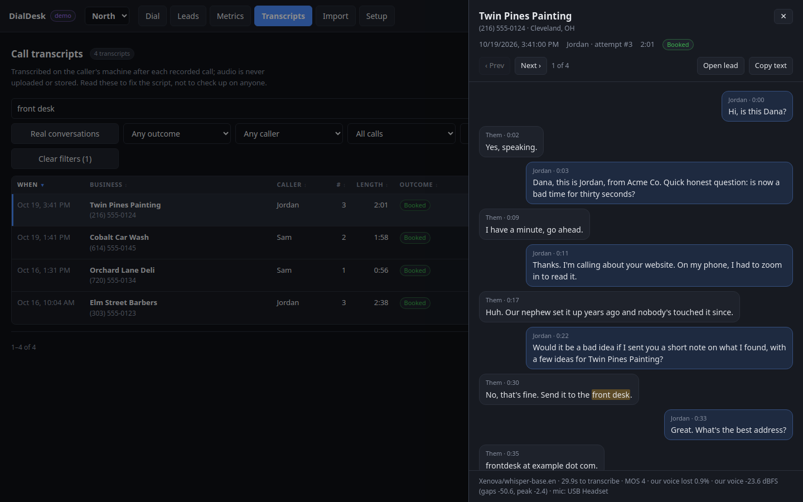
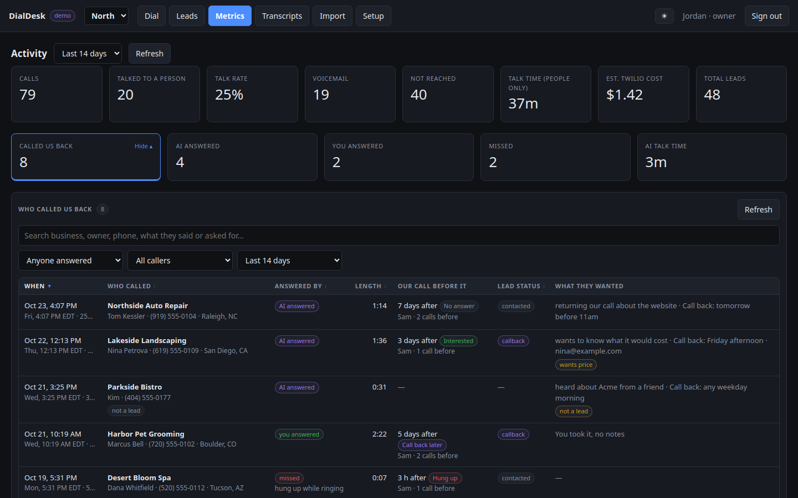
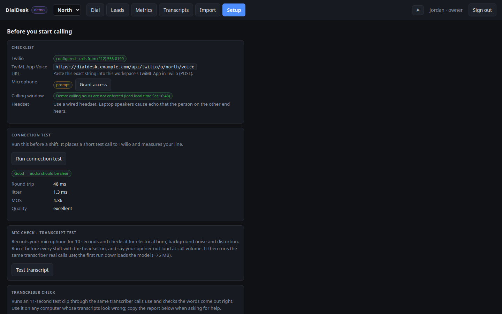
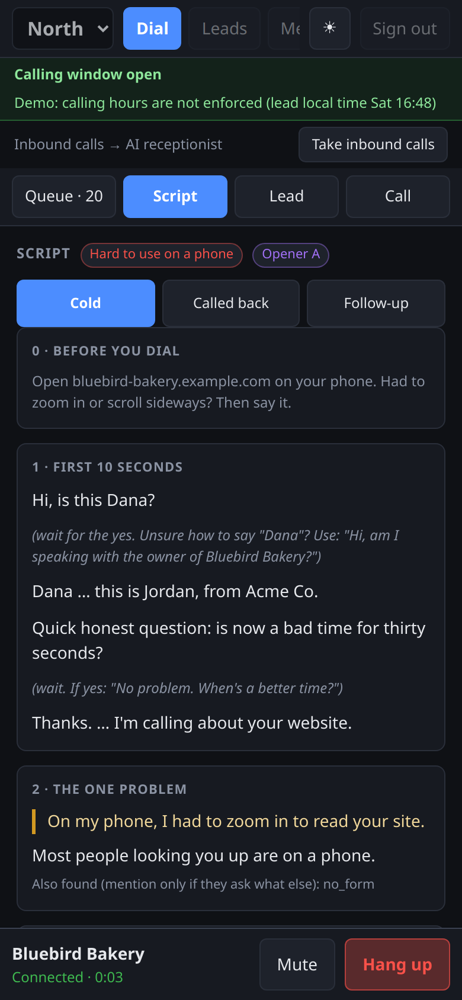
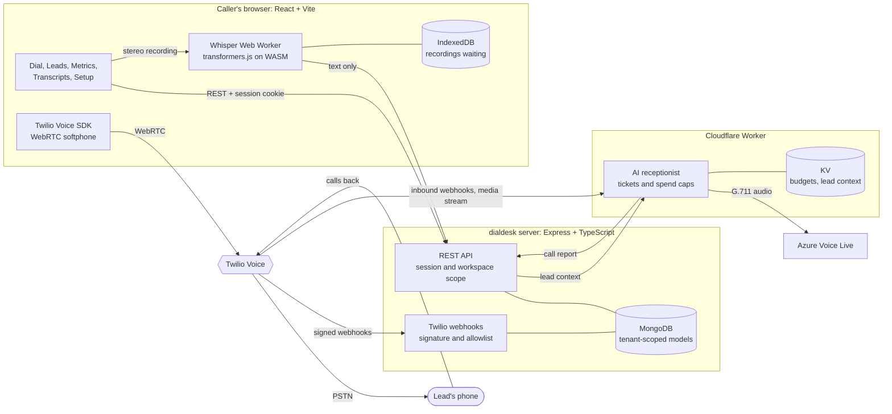

# dialdesk

Browser softphone and call CRM for small sales teams, with in-browser transcription and an AI receptionist.



**Live demo:** [saqlain-489.github.io/dialdesk](https://saqlain-489.github.io/dialdesk/). Demo mode: fictional data, and no calls are placed.

## What it does

- A caller picks a lead from a prioritised queue, reads a call guide generated for that lead, and
  dials with one click through the Twilio Voice SDK. Each outcome is one keypress (`0` to `9`, `H`
  or `O`), and the next attempt is scheduled automatically.
- Both sides of each call are recorded onto separate stereo channels and transcribed by Whisper in
  a Web Worker after hangup. Audio never leaves the caller's machine; only the text reaches the
  server.
- Calls to a workspace's number go to a Cloudflare Worker, which rings the team's browsers for 10
  seconds and, if nobody answers, connects the caller to an Azure Voice Live agent that says it is
  an AI, takes a message and reports the call to the CRM.
- Each workspace (one team) has its own leads, calls, metrics, Twilio account and number, and a
  guard in the data layer checks every query for the workspace.
- Metrics show talk rate by hour of the lead's day and by attempt number, outcomes, the pipeline,
  estimated Twilio cost, and a searchable list of everyone who called back.
- The server enforces a brand-wide do-not-call list and calling hours, records only leads in states
  the owner has allowed, and requires one human click per call.

| Reading a transcript | Metrics and AI-answered callbacks |
|---|---|
|  |  |

| Setup checks before calling | On a phone |
|---|---|
|  |  |

## Architecture



- `server/` is Node 22, TypeScript, Express and Mongoose, with 33 HTTP endpoints including three
  Twilio webhooks and the receptionist's ingest. In production it also serves the built client, so
  the browser and Twilio's webhooks reach the same origin.
- `client/` is React 18 and Vite with the Twilio Voice SDK v2 and transformers.js. Every page also
  works on a 390 px phone screen.
- `receptionist/` is a Cloudflare Worker with no runtime dependencies. It implements the Azure
  Voice Live WebSocket protocol itself, because the Azure SDK opens sockets with `new WebSocket()`
  and Workers open outbound sockets through `fetch()`.
- `docs/` has the [call flows](docs/call-flow.md) as sequence diagrams, notes on how the app
  [measures call audio](docs/call-audio.md), and how [in-browser transcription](docs/in-browser-transcription.md)
  works, including the time it failed.

## Engineering decisions and why

### Tenant isolation in the data layer

Every lead and call carries an `orgId`. A Mongoose plugin (`server/src/lib/tenantScope.ts`)
throws on any read or write of those models whose filter, or whose first `$match` stage, lacks an
`ObjectId` `orgId` at the top level, so an `orgId` hidden in `$or`, an `$in` list or a plain string
fails too. It refuses `bulkWrite`, unscoped `insertMany` and `estimatedDocumentCount` outright.
Brand-wide work such as the do-not-call fan-out opts out with `crossTenant: true`. Routes still
write the scope themselves and the plugin catches any that forget. A wrapped router turns a
violation into a 500 for that one request, where Express 4 would leave an unhandled rejection that
stops the process. Membership is re-checked on every request, and the client sends `X-Org` with
each call, so a second tab still showing the old workspace gets a 409 and writes nothing.

### One owner per business

A partial unique index on `phone` where `claimed: true` lets only one workspace own a business at a
time, whichever code path writes the lead. Moving a worked-out lead to another workspace takes three
idempotent steps (release the claim, insert the new tenure, mark the old one done), and a repair
pass at boot finishes any move a crash interrupted. The steps avoid transactions because the local
MongoDB runs as a standalone server.

### Encrypted Twilio credentials per workspace

Each workspace's API key secret and Auth Token are sealed with AES-256-GCM, using a 32-byte key
from the environment and a random 12-byte IV. The workspace id and field name are bound in as
additional authenticated data, so a sealed value copied onto another workspace or field fails to
decrypt. Queries leave the secrets out unless they ask for them. The `org` CLI reads the values
from a file, so they never land in shell history, and checks them against Twilio with read-only
calls before it stores anything.

### Toll-fraud protection

Anyone holding a stolen session can mint a token and start a call, so the TwiML the server returns
decides what gets dialed. It dials only a US number that the workspace owns as a lead, that is not
on the do-not-call list, inside calling hours in the lead's time zone, and only for a member of the
workspace. The attempt counter is incremented with a filter that re-checks ownership and
do-not-call, so a lead suppressed a moment earlier is never dialed. The receptionist's TwiML never
contains `<Number>` or `<Redirect>`, so a forged or looping webhook cannot place a billable call.
Tests assert both rules.

### Webhook signatures

Twilio signs the exact URL plus the sorted form parameters with the account's Auth Token. Rebuilding
that URL from request headers breaks behind a hosting proxy, so the server validates against
`PUBLIC_URL`, and it mounts the URL-encoded body parser before the webhook router so the signature
is computed over the real parameters. Each workspace has its own webhook path and token, the body's
`AccountSid` must match, and an unknown workspace gets the same 403 as a forged signature. The
worker reimplements validation with WebCrypto and a timing-safe comparison; its tests use vectors
produced by the official Twilio SDK, one of them Twilio's documented example.

### Spend caps on the AI receptionist

Before any Azure minute is spent, an admission check looks at a kill switch, a daily budget of AI
seconds, a per-caller daily cap and a concurrency cap: once when the call is handed over and again
when the media stream starts. The stream opens Azure only after redeeming a 60-second, single-use
HMAC ticket bound to the CallSid, with the workspace inside the signed payload. Each call has a hard
timer and a silence wrap-up, either side hanging up closes the other, and a storage error fails
closed to a spoken "we'll call you back". Caller audio is held back until the session is configured,
because Voice Live ends a session that receives five other messages first.

### Compliance on the server

"Stop calling me" said to one caller binds every workspace: the do-not-call list is brand-wide, and
both the importer and the voice webhook check it. Retries rotate across the calling window (9am,
2pm, 10am, 3pm), and a lead closes after five attempts. The receptionist says it is an AI in its
first sentence for every workspace, and a test checks that.

### Transcribing in the browser

Transcribing on the caller's machine keeps call audio off the server, costs nothing per minute, and
makes speaker attribution exact, because each leg has its own channel. It has costs too. It needs a
laptop: Whisper's memory use made iOS Safari reload the tab, so phones never record. The first run
downloads a 75 MB model and a 21 MB runtime. Accuracy on 8 kHz phone audio is enough to review a
call. Transcription must never compete with a live call for CPU, so recordings wait in IndexedDB and
run between calls. Recording also depends on consent: the browser records only leads whose state is
in `TRANSCRIBE_STATES`, and the server re-checks the lead's state before it accepts a transcript.
One Windows laptop once returned the same word salad for every call;
[the write-up](docs/in-browser-transcription.md) covers the cause (Whisper `q8` on WebGPU) and the
fix.

## Tests and CI

- Server: 49 tests in 12 suites (`npm --prefix server test`), run against a throwaway MongoDB
  database that each test file creates and drops. They cover tenant isolation through the real HTTP
  API, the tenant guard itself, Twilio webhook signatures and the dial allowlist, CSV import and
  inbound ingest, lead recycling and its repair pass, and the tenancy migration script run as a
  child process. Without MongoDB on `127.0.0.1:27017`, every suite is skipped with that reason
  instead of failing.
- Receptionist: 66 tests (`npm --prefix receptionist test`) on plain Node: signature vectors, TwiML
  safety, ticket replay and expiry, every spend cap, workspace routing, and whole AI calls driven
  through fake sockets, including barge-in, silence and the hard time cap.
- CI (`.github/workflows/ci.yml`): the server job typechecks, builds and runs its tests against a
  `mongo:7` service container, the client job typechecks and builds both the app and the demo, and
  the worker job runs its tests and a Wrangler dry-run bundle. A second workflow (`pages.yml`)
  publishes the demo build to GitHub Pages on every push to `main`.

## Quick start

### Demo mode (no backend, no Twilio)

```bash
git clone <this repo> dialdesk && cd dialdesk
npm --prefix client install
npm run demo                  # http://localhost:5174
```

The demo swaps the API client and the call device for in-memory fictional data: Acme Co., two teams
(48 and 12 leads, all with 555-01XX numbers), and two weeks of calls and transcripts. Dialing rings
and connects on a timer, hanging up runs a simulated transcription, and "Take inbound calls" rings
once with a callback. Nothing leaves the browser. `npm run build:demo` writes a static build to
`client/dist-demo`, and `node scripts/screenshots.mjs` recaptures the screenshots from it.

### Running it for real

Requirements: Node 22 (`.nvmrc`) and MongoDB.

```bash
npm run install:all
cp server/.env.example server/.env    # set JWT_SECRET and ORG_SECRETS_KEY (commands are in the file)
npm run dev:server                     # :4001
npm run dev:client                     # :5174, proxies /api to :4001
```

Nothing is seeded from the environment. Create a login and a workspace; every command that writes
prints a preview first and writes only with `--apply`:

```bash
npm --prefix server run set-password                                    # asks for username, password, spoken name
npm --prefix server run org -- create north --name North --company "Acme Co." --owner-name Jordan --apply
npm --prefix server run org -- add-member north jordan.acme --role owner --apply
```

The queue, CSV import, outcomes and metrics work without Twilio. To place calls, for each workspace:

1. In the Twilio console, limit Voice Geographic Permissions to the countries you call before you add
   a card. That caps the damage if a key ever leaks.
2. Buy a local number with Voice, create a Standard API key, and create a TwiML App whose Voice
   Request URL is the one the Setup page shows (`<PUBLIC_URL>/api/twilio/o/<workspace>/voice`).
3. Put the six `TWILIO_*` values in a private file (`private/` is gitignored) and load them with
   `npm --prefix server run org -- set-twilio north --from-file ./private/north-twilio.env`.
   The command checks the Auth Token, number and API key against Twilio with read-only calls, and
   stores the two secrets encrypted when you add `--apply`.
4. Optionally, deploy the receptionist and point the number's webhooks at it
   ([receptionist/README.md](receptionist/README.md)).

For production, `npm run build && npm start` serves the API and the built client from one process.
Set `PUBLIC_URL` to the deployed origin exactly, with no trailing slash, or every webhook fails
signature validation. The Auth Token and the API key secret are different credentials: the key
mints browser tokens and the token signs webhooks.

## Limitations

- There is no lead locking, so two callers in the same workspace could open the same lead at once.
- Transcripts need a laptop browser. Phones never record, and a tab closed during a call loses that
  call's recording; finished recordings survive in IndexedDB.
- Transcript accuracy on 8 kHz phone audio is good enough to review a call, not to quote it.
- The receptionist's caps use eventually consistent KV, so they are soft; the per-call timer is the
  hard limit.
- The voice webhook only dials US numbers, and the dialer is click-to-call by design: there is no
  auto-dialer.
- Metrics look at a recent window (up to 90 days), with no per-campaign attribution.
- Recording consent is configured by state code. Check the law for every state you add to
  `TRANSCRIBE_STATES`; nothing here is legal advice.

## License

[MIT](LICENSE)
