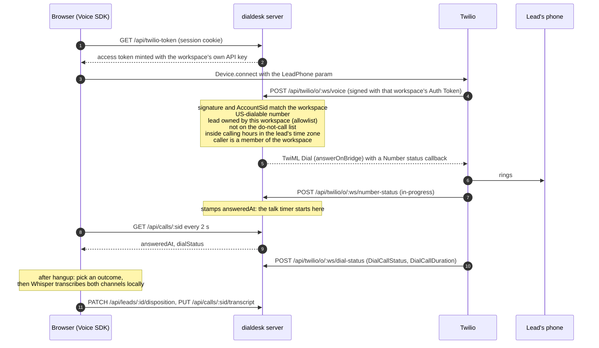
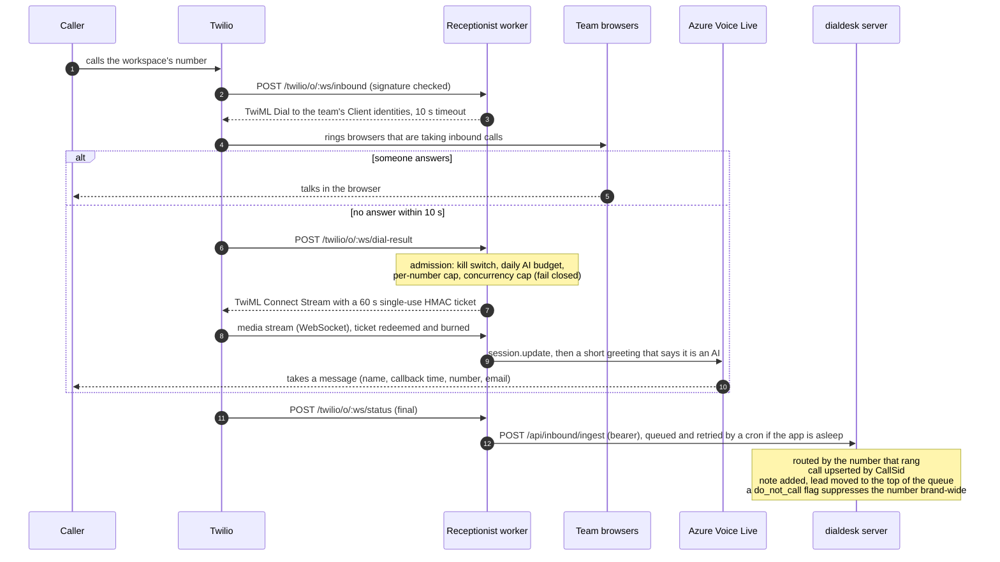

# Call flows

## Outbound: a click in the browser to a ringing phone

Any check that fails answers with a spoken `<Say>` and `<Hangup/>`, so nothing is dialed. Three
details carry the design:

- **The lead allowlist is the toll-fraud control.** The webhook dials only a number the workspace
  owns as a lead, so a stolen session can't reach a premium-rate line or bill one workspace for
  another's lead.
- **`answerOnBridge` is the first verb.** The caller hears the carrier's real ringback, so
  disconnected numbers and intercept messages are audible at once. A `<Say>` before it would
  answer the call and void it.
- **The talk timer starts from the server.** With `answerOnBridge`, the SDK's `accept` event fires
  when ringback media arrives, not when the lead picks up. Only the `<Number>` status callback
  knows the real answer moment.

## Inbound: a callback when nobody picks up

The worker never emits a `<Number>` or a `<Redirect>`, and every TwiML document ends in
`<Hangup/>`; tests assert all three. Its only REST call to Twilio moves an existing call onto the
spoken "we'll call you back" message.
